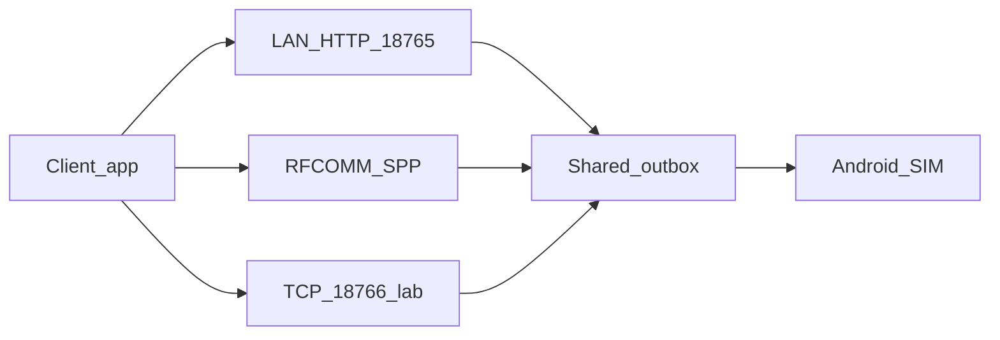
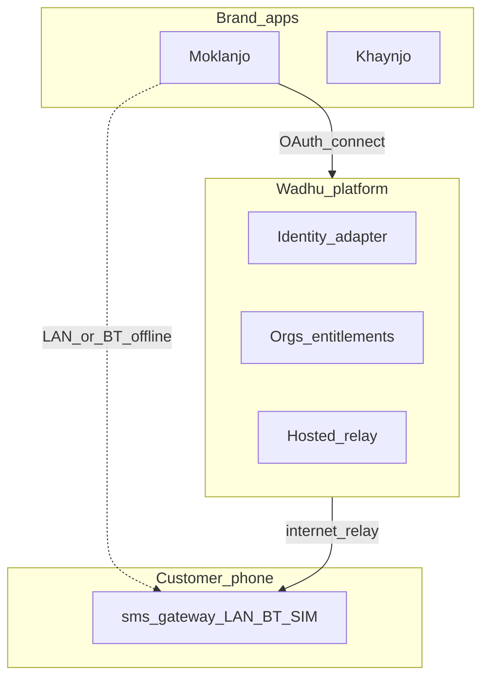

# Plan: Bluetooth completion → identity alignment

Status: **implementation landed**; this note is the readable plan form of what shipped.

Offline first (LAN + Classic RFCOMM), then treat ChatGPT’s Wadhu identity/monetization brief as **direction**, not a same-day build.



---

## Part A — Bluetooth (done first)

| Piece | Goal |
|--------|------|
| Java RFCOMM SPP server | `MakepadActivity` listen/`accept` on SPP UUID `00001101-…`, name **Wadhu SMS Gateway** |
| JNI byte pump | Rust reads/writes frames; framing stays in one place |
| `android_rfcomm_loop` | Accept → `handle_framed_client` → same outbox as LAN |
| Permissions | `BLUETOOTH_*` + runtime batch request from `btRfcommStart` |
| Lab TCP | Desktop `127.0.0.1:18766` same framing |
| Client / demo | `wadhu-sms-client::framed::FramedClient` + demo “Framed TCP (BT lab)” |
| Docs | [`apps/sms-gateway/docs/BLUETOOTH.md`](../../apps/sms-gateway/docs/BLUETOOTH.md) |

**Non-goals:** BLE GATT, Web Bluetooth, cloud/identity/billing.

**Verify (no cloud):** LAN HTTP with relay unused; framed TCP ping/send on lab port; phone BT chip **On** when RFCOMM listening.

**Android build tip:** pin the device with env prefix (not `export … cargo`):

```bash
ANDROID_SERIAL=10BD9M1FRJ000B2 cargo sms-gateway-android-dev
```

---

## Part B — ChatGPT identity plan (alignment only)



### Locked product split

| Layer | Who pays | wadhu.com account? |
|-------|----------|--------------------|
| SIM / carrier | SIM owner | No |
| LAN / Bluetooth | **Free forever** | No |
| Hosted relay + orgs | Wadhu subscription | Yes |
| Brand app | That brand | Connect only if using cloud SMS |

### Sequencing

```text
Done:     Classic RFCOMM + LAN HTTP + client framed lab
Next:     Freeze OpenAPI + client docs for brand apps
Later:    Identity → orgs → relay entitlements → Connect UX → Stripe
```

Do **not** block brand SMS on Firebase/Stripe. Full write-up:
[`docs/IDENTITY_AND_MONETIZATION_ALIGNMENT.md`](../IDENTITY_AND_MONETIZATION_ALIGNMENT.md).

---

## Follow-ups (build hygiene)

- Keep Android Java free of `BluetoothSocket.setSoTimeout` (API does not exist).
- Prefer `BluetoothManager.getAdapter()` / `SmsManager` via `getSystemService` (API 31+) so compile SDKs stay warning-clean without `@SuppressWarnings`.
